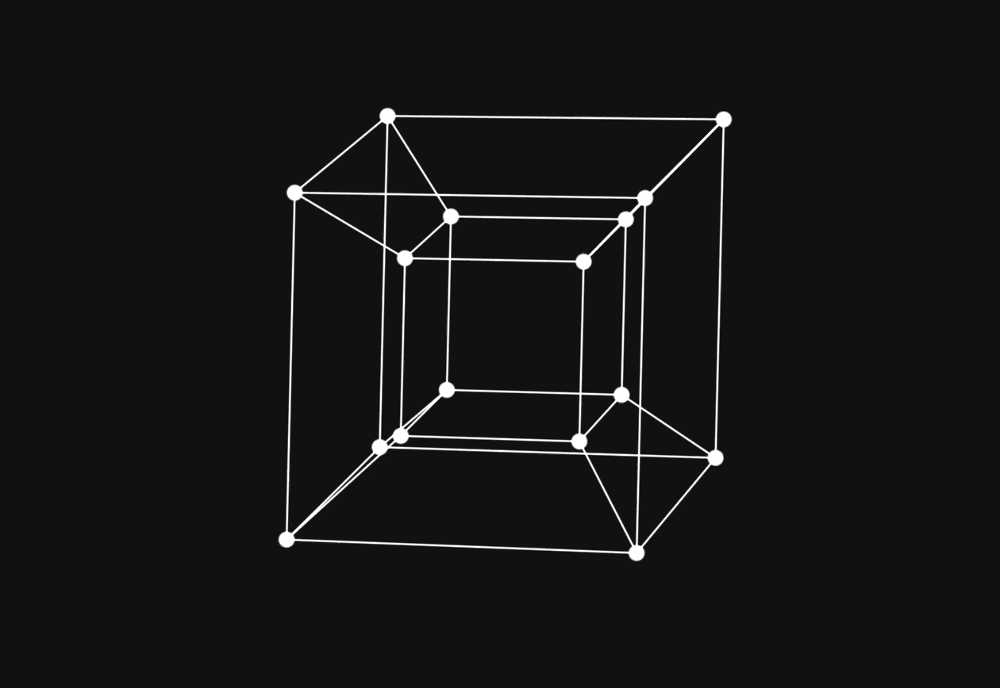
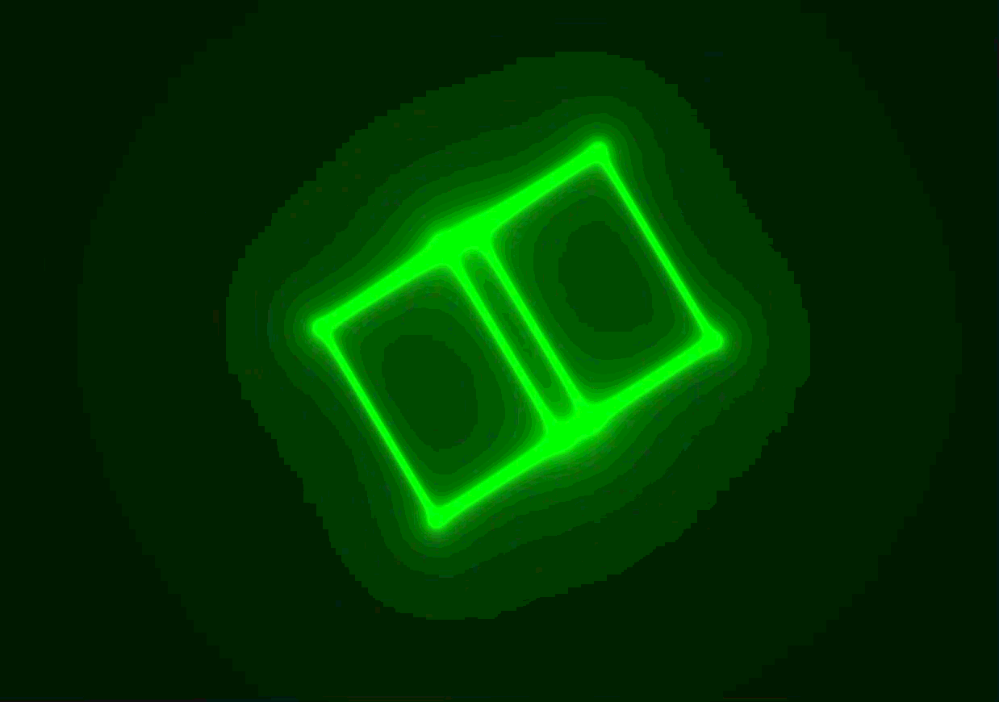

# GLSL Shaders

This project is a collection of shaders.
Every shader can be viewed in the browser using only WebGL2, with no other dependencies.

**[▶ Open the viewer online](https://AlphaKami.github.io/glsl-shaders/viewer/)**

## About this project
My original idea for this project dates back to 2023, when I was in my first year of university. 
I wanted to create a 4D hypercube rotation by applying point transformations in $\mathbb{R}^4$ space.
After that, I continued to delve deeper into GLSL, which led to the creation of several shaders.

This repo works as a shader archive, and I will upload more in the future.

### Examples

<p align="center">
  
</p>
<p align="center">
  
</p>
<p align="center">
  
</p>

## Shaders

| Shader | Description |
|--------|-------------|
| [`3D_Cube_Rotation.frag`](shaders/Hypercube/3D_Cube_Rotation.frag) | 3D cube projection |
| [`4D_Hypercube_Rotation.frag`](shaders/Hypercube/4D_Hypercube_Rotation.frag) | 4D Hypercube projection with rotation across 4D planes |
| [`4D_Hypercube_Rotation_Variant.frag`](shaders/Hypercube/4D_Hypercube_Rotation_Variant.frag) | Variant of the Tesseract with glow effects |
| [`Fractal_Glow.frag`](shaders/Fractals/Fractal_Glow.frag) | Colorful fractal |
| [`Fractal_Raymarch.frag`](shaders/Fractals/Fractal_Raymarch.frag) | Fractal rendered with raymarching |
| [`MovingLight_Raymarch.frag`](shaders/Raymarch/MovingLight_Raymarch.frag) | Raymarch scene with moving light source |
| [`Shapes_Raymarch.frag`](shaders/Raymarch/Shapes_Raymarch.frag) | Raymarch shapes |

## Repo structure

```
.
├── shaders/        # Fragment shader (.frag), divided by type.
│   ├── Hypercube/
│   ├── Fractals/
│   └── Raymarch/
└── viewer/         # Viewer WebGL2
    ├── index.html
    └── shaders.json
```

---

## How to use the viewer

### Online

Open the GitHub Pages link above. Select a shader from the top menu;
you can pause or restart the animation. The **Code** link opens the shader's source code.
You can share a specific shader using `?s=<name>`—for example, `viewer/?s=tesseract`.

### Locally

The viewer loads shaders using `fetch`, so it will not work if you open the file via `file://`.
Start a static server from the root of the repo:

```bash
python3 -m http.server 8000
```

then open <http://localhost:8000/viewer/>.

## Supported uniforms

The viewer provides these uniforms (using both naming conventions):

| Uniform | Type | Meaning |
|---------|------|-------------|
| `iResolution` / `u_resolution` | `vec2` / `vec3` | Canvas size, in pixels |
| `iTime` / `u_time` | `float` | Time since start, in seconds |
| `iMouse` / `u_mouse` | `vec4` | Mouse position |
| `iFrame` | `float` | Frame number |

Both GLSL 1.00 and `#version 300 es` shaders are supported.
Shaders must define `main()` (not the `mainImage` function used in Shadertoy).

## Adding shaders

1. Save the `.frag` file in a folder under `shaders/`.
2. Add an entry to `viewer/shaders.json`:

```json
{
  "name": "shader_name",
  "title": "Fancy Title",
  "path": "../shaders/Type/My_Shader.frag"
}
```

---

## Requirements

A browser with WebGL2 support.

## License

Distributed under the [MIT](LICENSE) license.
See also [THIRD PARTY](THIRD_PARTY) for shaders derived from the work of others.